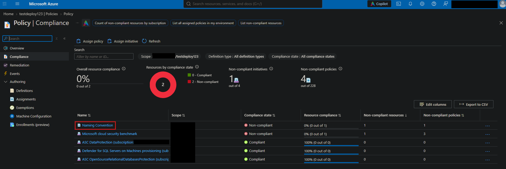
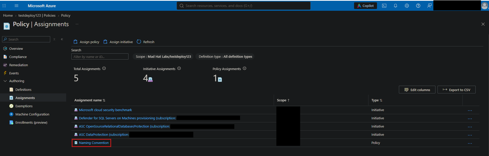
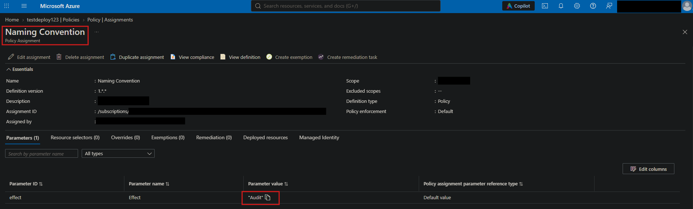

# Operation Dead Deploy: Investigating an unauthorized resource deployment

## Scenario
Two days ago, a junior intern at Mad Hat Labs was given temporary contributor access to spin up a "test environment" for an experiment that would not be presented to leadership. The intern was not familiar with the company's governance standards and they cut several corners. They deployed quickly and left for the weekend. You are the on-call Azure engineer who came in Monday morning and found this in the subscription. Your job is to assess the damage, identify what governance failed, and document the evidence.

## Environment
Live multi-user Azure **training** tenant with Reader access. Investigating resource groups, tags and naming conventions.

## Investigation

Step 1. After signing in with my credentials, I look into the Resource groups for this specific Tenant. I quickly notice one of the RGs do not match the standard naming convention for this Tenant's resource groups.

Step 2. I move into the misnamed resource group to find that it only includes one resource, a storage account.

Step 3. I dig further and investigate the lone storage account to see why this resource was allowed to be created in the first place. Going from top to bottom down the blade menu, Overview and the Activity log weren't throwing any real red flags, but the Tags showed that the intern at least tagged a test resource as instructed (shown below).

Step 4. I wanted to review the RG's deployments to see why this storage account resource was successful in being created while avoiding any naming convention rules in place. 

Step 5. Next, since the resource slipped through our known naming convention policies, I navigated to the RG's policies dashboard to see what happened. As seen below, our policy with regards to naming convention is showing as "Non-compliant".

Step 6. Lastly, I investigated the policy assignment for our Naming Convention policy to see what the configured effect would be when this policy ran. I immediately noticed that the effect is only set to 'Audit' the policy when the effect is triggered, thus allowing the intern's resource to be deployed. This parameter value will need to be set to 'deny' in order to prevent resources from being created when they don't follow the naming convention policy.

## What broke / what surprised me
What surprised me with this investigation was that a resource was able to be spun up with almost zero pushback even after it completely avoided the naming convention policy we had in place for this Tenant. Nothing broke exactly, but this was a great example of how a simple misconfiguration can allow for a resource to be created that will begin accumulating cost for the organization.

## Findings and recommendations
From this investigation, I have determined that more attention to detail should be made to the policy effect values that we have in place. I would recommend in the future that we ensure to set a 'deny' effect on policies involving naming conventions. Next, I would recommend we be more careful as to whom we give 'Contributor' access to without first making sure our policies are configured properly. I'm thankful that this resource was caught early before it started accumulating bigger costs for the Tenant.

## What I learned
- Naming convention is important for many reasons (organization, cost analysis and resource searching)
- Policy effect parameters being misconfigured seem minor, but can have a huge impact in how resources are handled.
- Contributor access should be given out more conservatively so resources cannot be so easily created.
