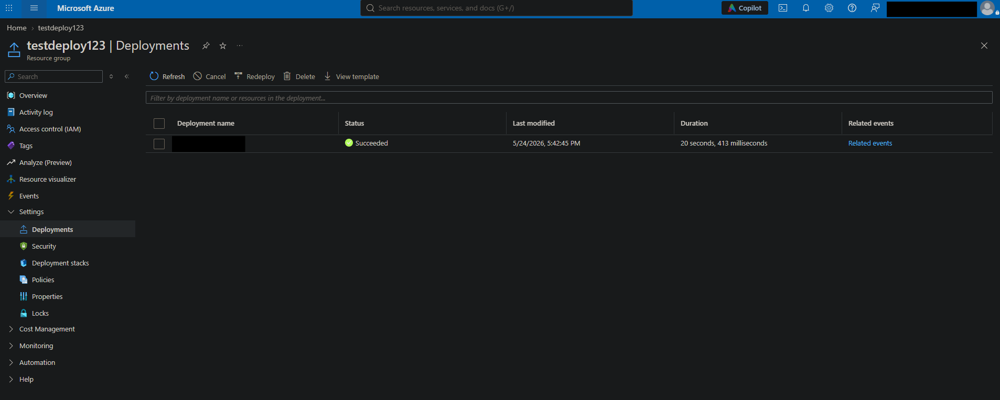

# Operation Dead Deploy: Investigating an unauthorized resource deployment

## Scenario
Two days ago, a junior intern at Mad Hat Labs was given temporary contributor access to spin up a "test environment" for an experiment that would not be presented to leadership. The intern was not familiar with the company's governance standards and they cut several corners. They deployed quickly and left for the weekend. You are the on-call Azure engineer who came in Monday morning and found this in the subscription. Your job is to assess the damage, identify what governance failed, and document the evidence.

## Environment
One list: platform, services, tools, access level. Honest framing: "live multi-user Azure training tenant, Reader access."
Live multi-user Azure training tenant with Reader access. Investigating resource groups, tags and naming conventions.

## Investigation
<!--
The core. Numbered steps IN YOUR OWN WORDS: what you looked at, what you found, what you concluded at each step. 6 to 12 screenshots of meaningful moments (portal views, query results, before/after).
-->
Step 1. After signing in with my credentials, I look into the Resource groups for this specific Tenant. I quickly notice one of the RGs do not match the standard naming convention for this Tenant's resource groups.

Step 2. I move into the misnamed resource group to find that it only includes one resource, a storage account.

Step 3. I dig further and investigate the lone storage account to see why this resource was allowed to be created in the first place. Going from top to bottom down the blade menu, Overview and the Activity log weren't throwing any real red flags, but the Tags showed that the intern at least tagged a test resource as instructed (shown below).

Step 4. I wanted to review the RG's deployments to see why this storage account resource was successful in being created while avoiding any naming convention rules in place. 

<!--
## What broke / what surprised me
The most credible section in the document. Dead ends, wrong guesses, the thing that took an hour. Employers know real work is messy. This section separates you from certificate collectors.

## Findings and recommendations
What you determined, plus 2 or 3 recommendations as if you were reporting to the resource owner.

## What I learned
3 to 5 bullets. At least one technical, one "what I'd do differently."
-->
