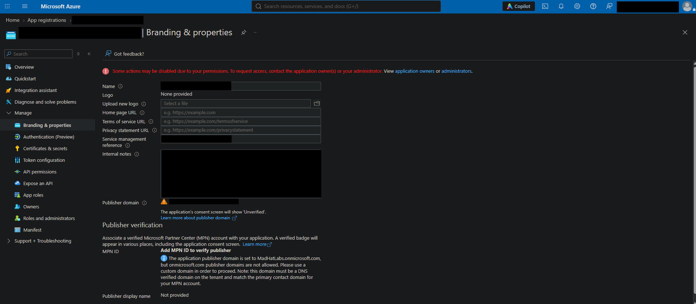
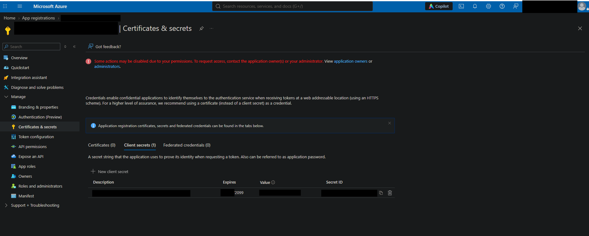
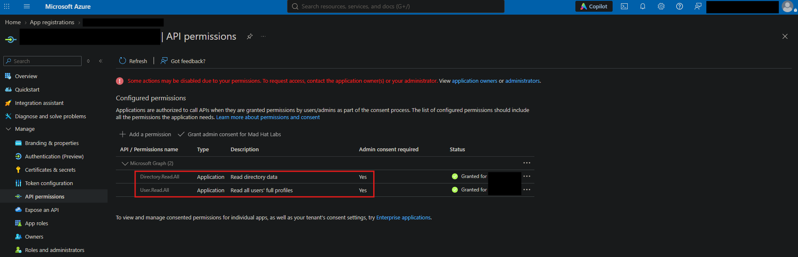
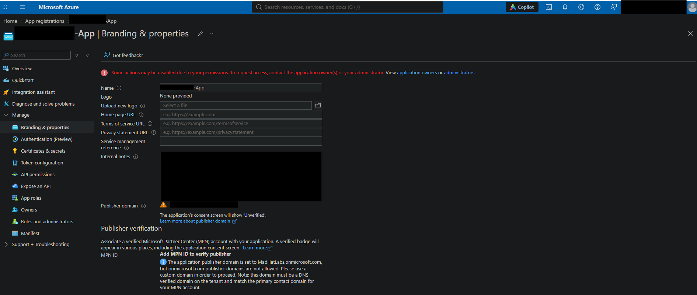
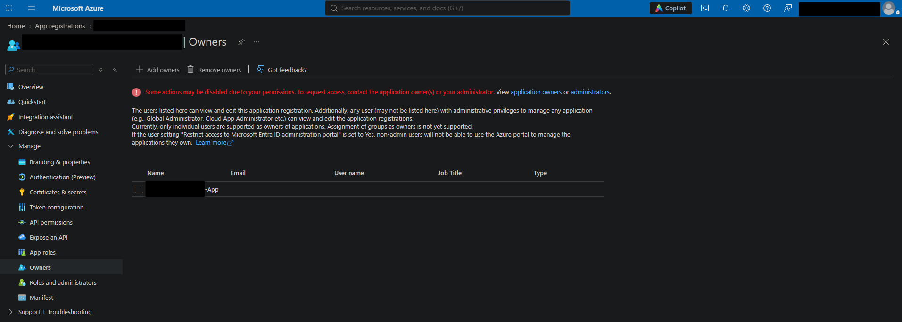
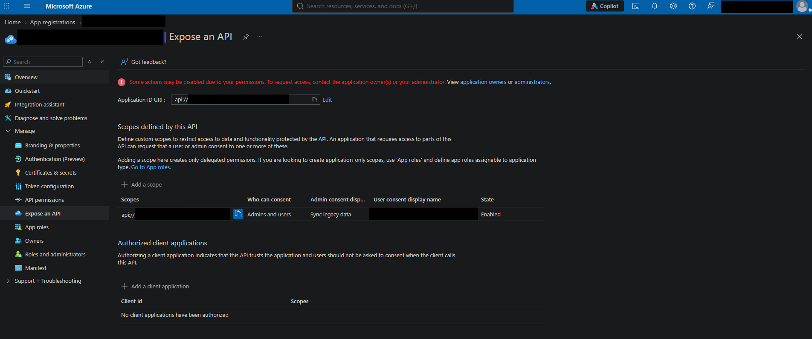

# The Stolen Identity: Investigating a consent-phishing attack

## Scenario
Reconstructed a five-stage OAuth consent-phishing kill chain in a live Azure tenant through forensic analysis of two linked app registrations.

## Environment
Live multi-user Azure **training** tenant with Reader access. Investigating a legacy app registration.

## Investigation

Step 1. ENTRY - A user was phished and also completed MFA. the attacker then had stolen a session token that satisfied all Conditional Access policies that were set in place. The user, I came to find out, was still registered as an Owner on one of the tenant's legacy apps. Inside the app's Branding & properties page, the incident team had left an internal note disclosing what user was phished.

Step 2. ESCALATE - Since the phished user was set as an Owner to this legacy app, the attacker exploited that ownership to mint a new client secret on the app. This secret allowed the attacker to authenticate through the client credentials flow as the service principal itself. This gave the attacker inherited app directory permissions without the need to sign-in as a human ever again. Below is a screenshot of the attacker's newly minted secret. Note the expiration date.

Step 3. PIVOT - Since a single credential or secret isn't a permanent solution for maintaining access, I went looking to see where the attacker may have pivoted. Opening the API permissions blade on the legacy app, I noticed that two very general Read.All permissions were live and set with admin consent. The blast radius with these two permissions has the potential to be massive.

Since standard Entra ID users can register new applications, I then investigated if any new apps were registered. Surely enough I found a recently registered app, seen below.

Since the attacker gets Owner permissions from the app they just registered and have compromised a user account that already has Owner permissions on our original legacy app, I next looked to see if the newly registered app's service principal was added to the legacy app's Owner. Seen below, this turned out to be the case. Now our attacker can mint new credentials indefinitely.

Step 4. PERSIST - Since most breaches lead to a credential/secret rotation, the attacker wanted to put in a persistence mechanism. Upon investigating the Expose an API blade for our legacy app, I discover that there is a custom scope delegating access to our legacy app's application ID URI. So even if/when the custom secret created earlier gets deleted, the attacker can carry out a separate phishing campaign using their rogue credentials and this now exposed API.

Step 5. LOOT - With the custom scope set on the legacy app's Expose an API blade and the rogue app being in the attacker's full control, the only thing needed was to collect tokens from actual users when they are prompted to consent. Using a trap redirect URI, the attacker can forge their own custom phishing URL using the rogue app's client ID, the redirect URI and the expose an API string.

## What broke / what surprised me
What surprised me with this investigation was the level of oversight by the security team. A user account having full Owner rights to a legacy application with the inability to maintain higher security protocols should be configured way more strictly. Utilizing permissions of a standard user and simply registering a rogue app to apply Owner rights to another app seems innocent enough until someone who understands what they're doing gains privileged access.

## Findings and recommendations
From this investigation, I have discovered that there is way more involved in defending the Identity plane of an Azure environment and encourage IAM professionals to really deep-dive their configurations and permission grants.

## What I learned
- Phishing works, but persistence requires thinking outside the box.
- Legacy apps should be analyzed more frequently to discover any cracks in their configuration and user access.
- Users with higher privileged permissions should be required to learn how these types of phishing campaigns truly work.
