# The Privilege Audit

## Azure Role-Based Access Control (RBAC) | Identity & Access Management | Azure CLI | Privileged Identity Management (PIM)

## 1. Executive Summary
I conducted a privileged access management (PAM) audit within the Mad Hat Labs Azure tenant. My search was to find out who had access to what resources and why. 

More specifically I was assessing role-based access controls (RBAC), role assignments, least privilege and privileged identity management (PIM).

## 2. Scope & Methodology
**Environment:** Mad Hat Labs - a live Azure training tenant 
**Access:** Reader access initially, activated to a PIM-eligible Operative account 
**Tools**: Azure Portal, Azure CLI, Azure Resource Graph, Kusto Query Language (KQL), Privileged Identity Management (PIM)

## 3. Findings & Observations
### Finding 01 - 
**Audit Methodology:** Identity and Access Management (IAM)

I began the audit with a no-tooling approach first using the Access control (IAM) interface in the Azure portal. I exported the role assignments on my target subscription into a CSV file.

<!-- 
The core. Numbered steps IN YOUR OWN WORDS: what you looked at, what you found, what you concluded at each step. 6 to 12 screenshots of meaningful moments (portal views, query results, before/after).

## What broke / what surprised me
The most credible section in the document. Dead ends, wrong guesses, the thing that took an hour. Employers know real work is messy. This section separates you from certificate collectors.

## Findings and recommendations
What you determined, plus 2 or 3 recommendations as if you were reporting to the resource owner.

## What I learned
3 to 5 bullets. At least one technical, one "what I'd do differently."

-->