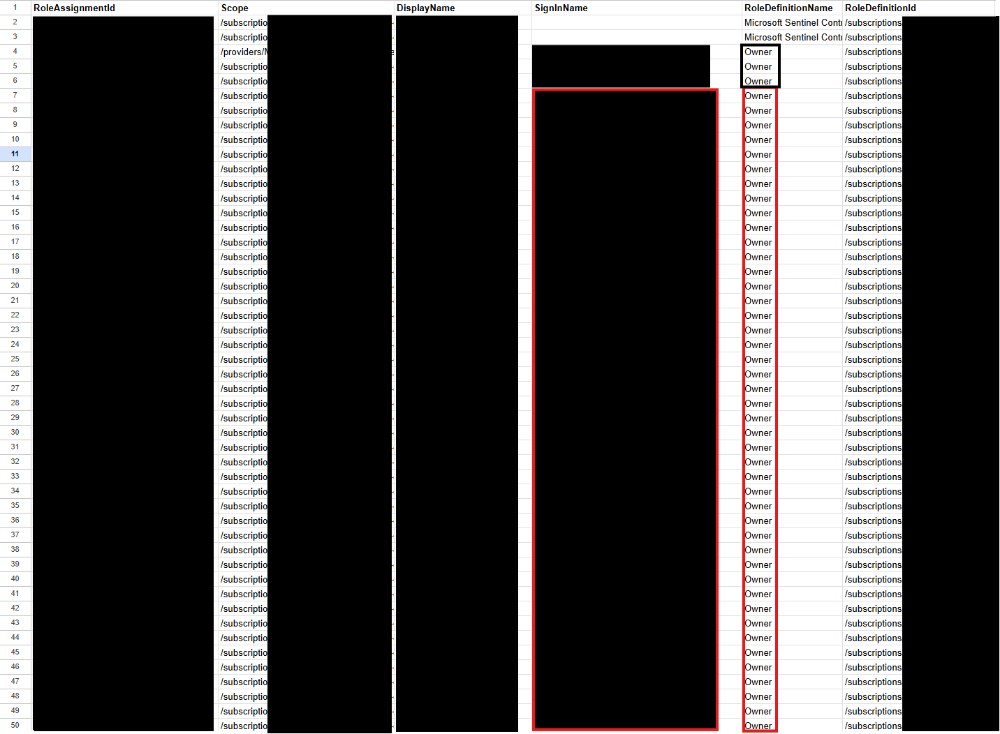
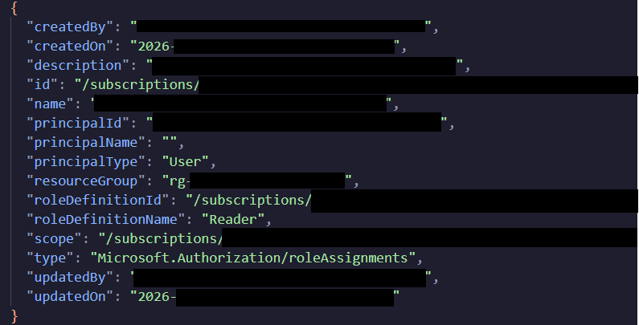
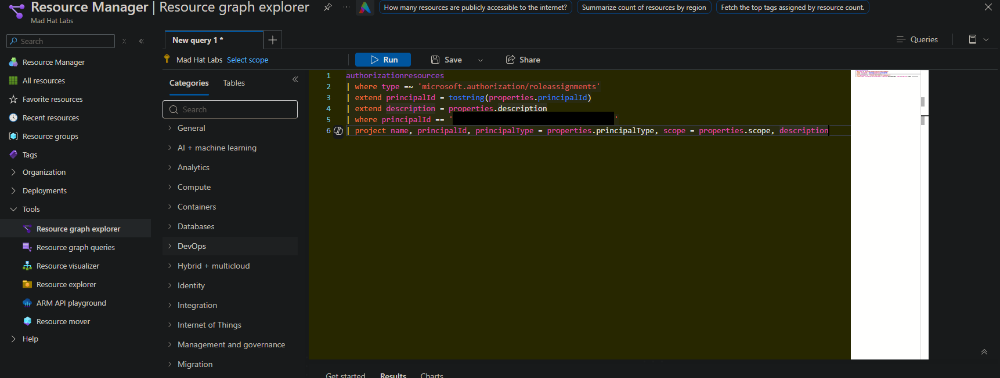

# The Privilege Audit

## Azure Role-Based Access Control (RBAC) | Identity & Access Management | Azure CLI | Privileged Identity Management (PIM)

## 1. Executive Summary
I conducted a privileged access management (PAM) audit within the Mad Hat Labs Azure tenant. My search was to find out who had access to what resources and why. 

More specifically I was assessing role-based access controls (RBAC), role assignments, least privilege and privileged identity management (PIM).

## 2. Scope & Methodology
**Environment:** Mad Hat Labs - a live Azure training tenant 
**Access:** Reader access initially, activated to a PIM-eligible Operative account 
**Tools**: Azure Portal, Azure CLI, Azure Resource Graph, Kusto Query Language (KQL), Privileged Identity Management (PIM)

## 3. Findings & Observations
### Finding 01 — Abundance of Owner role assignments 
**Audit Methodology:**
Identity and Access Management (IAM)

I began the audit with a baseline no-tooling approach first using the Access control (IAM) interface in the Azure portal. I exported the role assignments on my target subscriptions into a CSV file.

Redactions outlined in red below signify the <u>same</u> user account with Owner access on *multiple* subscriptions.

<em>Figure 01 - Redacted export of IAM role assignments inside targeted Azure tenant subscriptions.</em>

**Discovery:** 
This one user having Owner permissions to multiple subscriptions raises a major concern with how they acquired these permissions in the first place. Was this user's permissions applied manually or through a re-occurring script?

**Limitations:** 
Given the methodology and my access level during this audit, my export did not authorize me to see the members inside of subscription groups, thus overlooking potential Owners inside of groups or potential orphaned users from deleted accounts.

**Recommendation:** 
Maintain a quarterly review with your security team to ensure that any unused, high-privileged accounts are removed and update any dynamic group scripts.

### Finding 02 — The orphan account
**Audit Methodology:**
Azure CLI

Since I wanted to investigate any deleted "orphan" accounts that could be living in the tenant, I decided to run a Powershell command to iterate through a specific resource group of which I had access. 
<code>az role assignment list --resource-group rg-REDACTED</code>

**Discovery:** 
The resulting information yielded a role assignment object that had an empty value for it's principalName. This points towards a deleted "orphaned" account that still has permissions assigned to it.

<em>Figure 02 - Screenshot of a role assignment of an orphaned user account with remaining permissions.</em>

**Limitations:** 
The scope I was limited to allowed me to only iterate through this one specific resource group with the CLI.

**Recommendation:** 
The Powershell command I ran can be turned into a script and repeated often at a scope larger than what I had access to in order to keep up to date with the presence of orphan accounts with permissions linked to them. 

### Finding 03 — The orphan account
**Audit Methodology:**
Azure Resource Graph, Kusto Query Language (KQL)

I used the Azure Resource Graph Explorer to run a KQL query that would allow me to sweep every resource tied to the orphan account's principalId.

The KQL query that I ran was: 

<em>Figure 03 - KQL query ran inside of a tenant's Azure Resource Graph filtering a specific principal id value.</em>

**Discovery:** 
Using KQL, I am more quickly able to run a search on role assignments across all available scopes and return specific, filtered results.

**Limitations:** 
While being able to iterate entire subscriptions' role assignments with one query, KQL does not render 'eligible' role assignments, only active assignments. 

**Recommendation:** 
Along with using IAM auditing and Azure CLI commands to observe recurring access, I recommend using customized versions of my KQL query above to help dig deeper.
<!--

## What broke / what surprised me
The most credible section in the document. Dead ends, wrong guesses, the thing that took an hour. Employers know real work is messy. This section separates you from certificate collectors.

## Findings and recommendations
What you determined, plus 2 or 3 recommendations as if you were reporting to the resource owner.

## What I learned
3 to 5 bullets. At least one technical, one "what I'd do differently."

-->
