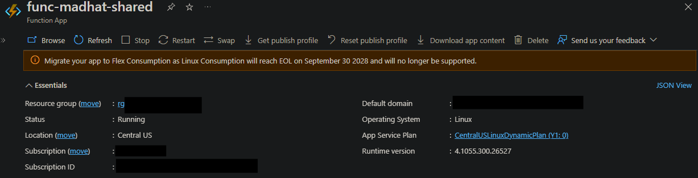
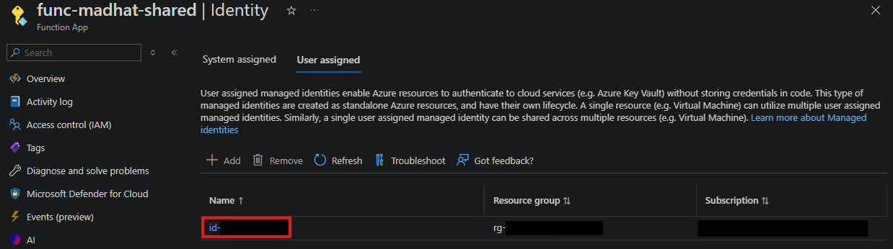
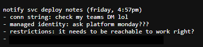
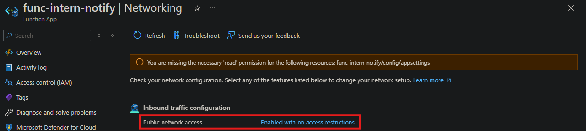
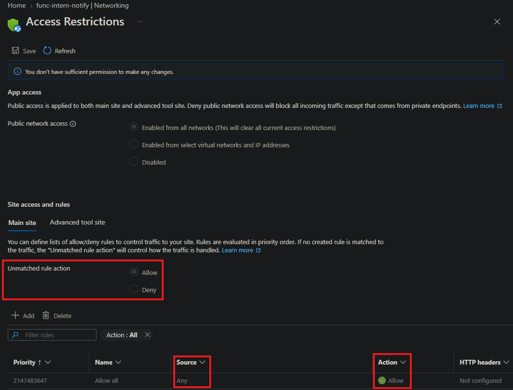
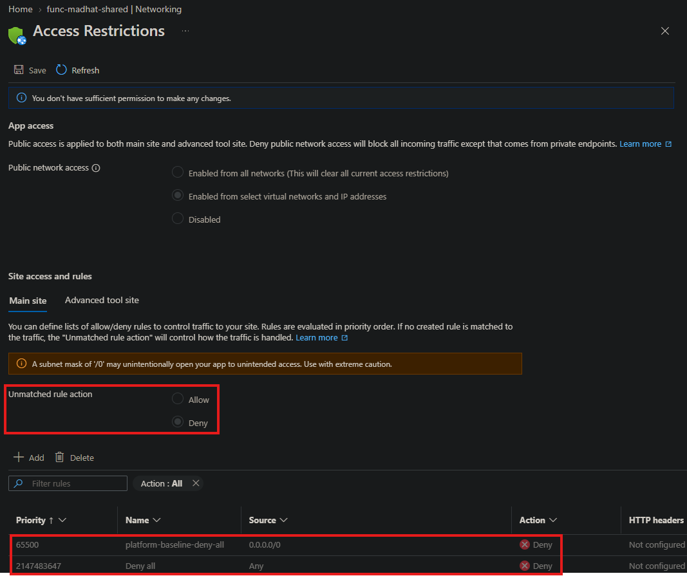

# The Friday Deploy

## Baseline Comparison | Configuration Drift Analysis | Azure Function Apps | Production Deployment Review

## 1. Executive Summary
I was tasked to review a function app deployed by our intern (on a Friday, no less) before it gets shipped to production. The function is to act as a new 'notification service'. 

I compared this particular deployment to the compute stack of our production baseline.

## 2. Scope & Methodology
**Environment:** Mad Hat Labs - a live Azure training tenant 
**Access:** Reader access to the production resource group 
**Tools**: Azure Portal, 

### <em>The Review Route</em>

There are five questiosn that can cover the biggest converns within every compute review:

1. Where is it?
2. Who is it?
3. Where does its data go?
4. Who can reach it?
5. ...and what do we fix first?

## 3. Findings & Observations
### Finding 01 — The **Where** 

| Properties | func-intern-notify                                        | func-madhat-shared                              |
|----------------------|---------------------------------------------|-------------------------------------|
| Location / Region   | Australia East (australiaeast)  | Central US (centralus)
|      Status       | Running     | Running     |
| App Service Plan | AustraliaEastLinuxDynamicPlan(Y1: 0)                   | CentralUSLinuxDynamicPlan(Y1: 0)                

### Overview of <em>func-intern-notify</em>

<em>Figure 01 - Redacted overview section of a function app named func-intern-notify.</em>

### Overview of <em>func-madhat-shared</em>

<em>Figure 02 - Redacted overview section of a function app named func-madhat-shared.</em>

**Discovery:** 
To answer the 'where' portion of our review, I compared the region locations of the intern's deployment with our production baseline. The intern had set their deployment's region to Australia East when the rest of production deploys to Central US.

The moving of data out (data egression) of Australia East back to other production resources in Central US would cause additional hidden Azure charges as well as increase the latency for every type of request being made to this function app. 

**Recommendation:** 
Change the intern's deployment region / location to Central US (centralus) to match our production baseline, func-madhat-shared.

### Finding 02 — The **Who**

| Managed Identities | func-intern-notify                                        | func-madhat-shared                              |
|----------------------|---------------------------------------------|-------------------------------------|
| System assigned   | Status: Off  | Status: Off
|      User assigned       | N/A     | **id-madhat-shared**     |
|          

**Discovery:** 
The purpose of reviewing the **who** is to find out how this deployment authenticates. The managed identities of the intern's deployment when weighed against the baseline showed me a lack of <u>both</u> <em>system assigned</em> identities and <em>user assigned</em> identities. 

The production baseline however; while it has no system assigned identities, it does have a single user assigned identity. As seen below:

<em>Figure 03 - Screen grab of a function app (func-intern-notify)'s system assigned identities dashboard.</em>

 

<em>Figure 04 - Screen grab of a function app (func-intern-notify)'s user assigned identities dashboard.</em>

 

<em>Figure 05 - Screen grab of a function app (func-madhat-shared)'s system assigned identities dashboard.</em>

 

<em>Figure 06 - Screen grab of a function app (func-madhat-shared)'s user assigned identities dashboard. The single identity name information has been redacted.
</em>

**Recommendation:** 
It is always good practice to have one type of managed identity on any production deployed resource.

### Finding 03 — The **Leak**
**Discovery:** 
Since I confirmed the intern's deployment had zero managed identities to handle authentication, I went looking to see what potential public-facing data could be found.

Finding a storage account within the same resource group as func-intern-notify, I soon discovered a list of containers, one of which had it's **Anonymous access level** set to 'Blob' instead of 'Private', like the rest of the containers. This particular container's 'Name' was clearly belonging to the intern.

<em>Figure 07 - Screen grab of the intern's storage account with evidence of a publicly accessible container.</em>
 

Inside the non-private container was a single .txt file that contained some of the intern's notes. I opened up the .txt file to discover that the file's URL is in plaintext on the properties page.

 
<em>Figure 08 - Screen grab of the intern's storage account with a public facing .txt file containing it's plaintext URL.</em>
 

I wanted to actually prove the real exposure of this file, so I copied the URL and pasted it into a private browser window that has me signed into nothing. To my surprise, the URL directs me to the contents of the .txt file. No account sign-in or token required. Publicly exposed to the entire internet for anyone who scrapes this URL.

 
<em>Figure 09 - Screen grab of the intern's public facing .txt file's contents, providing information about the app's connection string.</em>
 

**Recommendation:** 
The Anonymous access level of this deployment's storage account containers needs to be set to 'Private', no exceptions. Going back to a previous recommendation of using managed identities. Those would remove all need to jot down connection strings inside of .txt files.

### Finding 04 — The **Door**

**Discovery:** 
After the discovery of the public facing .txt files, I then wanted to look into who is/was able to reach it. My first destination was the 'Networking' settings for the intern's function app. This would allow me to see it's inbound and outbound traffic configuration.

The first properties listed in the 'Networking' settings are for inbound traffic. I notice immediately that the **Public network access** is set to <em>Enabled with no access restrictions</em>. The door is wide open to this app deployment and thus, anyone on the internet can access the aforementioned .txt file.

 
<em>Figure 10 - Screen grab of the intern's function app (func-intern-notify) Networking settings, showing enabled and unrestricted public network access.</em>
 

Digging deeper into the inbound Public network access configuration, I go to the Access Restrictions dashboard. I notice a couple of things: 
1.  The **Unmatched rule action**, which is the default behavior applied to incoming requests that do not match any defined access restriction rule, was set to 'Allow'. With no rules actually set in place, this unmatched rule action would fire 100% of the time.

2. The bottom part of the Access Restrictions configuration page shows us the default **Action** and **Source** property values. 
Source, being the origin of incoming traffic and Action being whether or not that source has access. The intern's function app had a Source value of 'Any' and an Action value of 'Allow'.

It needs to be said, again, that the main job of this function app was to run a scheduled notification service. It has no need to take inbound requests, period.

<em>Figure 11 - Screen grab of the intern's function app Access Restrictions dashboard.</em>
 

When comparing these Networking settings to our production baseline, Inbound public network access for the baseline is set to 'Enabled with access restrictions'. 

Digging deeper, the Inbound traffic is configured with one baseline 'Deny' rule and one fallback 'Deny All' rule. With one or more rules defined, this sets our Unmatched rule action to implicitly 'Deny' unmatched traffic by default.

<em>Figure 12 - Screen grab of the intern's function app Access Restrictions dashboard.</em>
 

**Recommendation:** 
The Inbound traffic configuration for the intern's deployment needs to be set to 'Enabled with access restrictions' with the same 'Deny' rules set in place as the func-madhat-shared resource.

### Finding 05 — The **Call**

The last portion of the review route is the call, or the decision of **what gets fixed today**.

### <em>Security Risk Comparison</em>
| Priority <em>(1 highest - 4 lowest)</em>               | Finding                                        | Resolution                              |
|----------------------|---------------------------------------------|-------------------------------------|
|   1   | Publicly Exposed Container      | Container must be closed today  |
| 2            | Open Front Door to currently unused connection string | Refrain from putting connection strings in plaintext files                   |
 | 3                | No Managed Identities | Apply at least one managed identity to help with secret leak prevention
|     4       | Wrong Region      | Update region / location next deployment    

### Per the table above, my security risk priority and what needs to happen today is the closing of the container that holds the exposed .txt file.
<!--
## What surprised me
What surprised me about this deployment review was .

## What I learned
- Azure's IAM interface is a good starting point, but it doesn't always show the full picture of who has access and where.

- Using Azure CLI, Resource Graph, KQL, and PIM helped me dig deeper and uncover additional role assignments and potential access concerns.

- I learned the importance of understanding the difference between active and eligible role assignments, and how both need to be reviewed.

- Excessive permissions can easily go unnoticed when access isn't regularly audited.

- Most importantly, using multiple tools and approaches gives me a much better understanding of who has access to what, how they got it, and whether that access is actually necessary.
-->