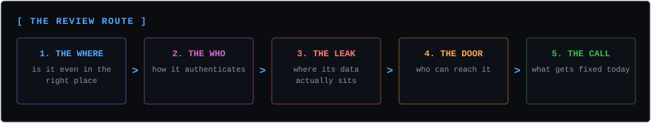
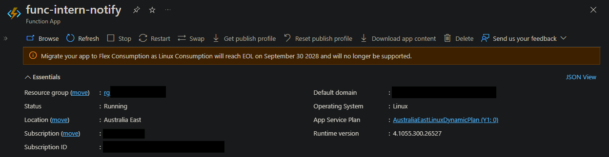
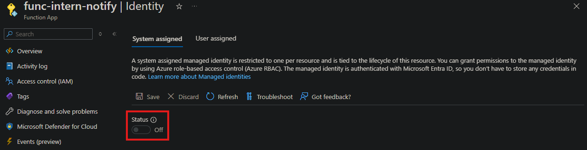
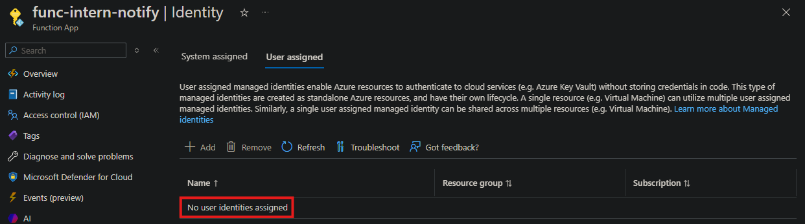
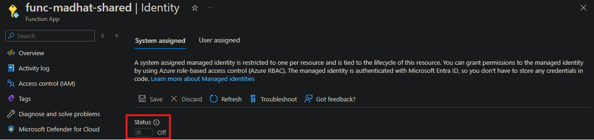
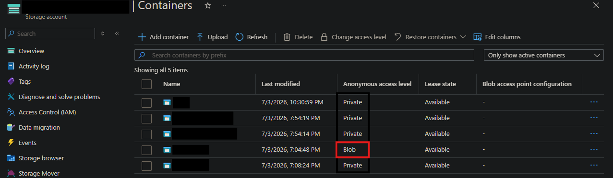
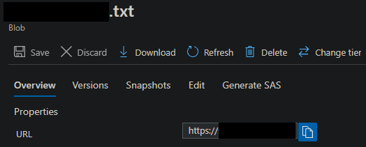

# The Friday Deploy

## Baseline Comparison | Configuration Drift Analysis | Azure Function Apps | Production Deployment Review

## 1. Executive Summary
I was tasked to review a function app deployed by our intern (on a Friday, no less) before it gets shipped to production. The function is to act as a new 'notification service'. 

I compared this particular deployment to the compute stack of our production baseline.

## 2. Scope & Methodology
**Environment:** Mad Hat Labs - a live Azure training tenant 
**Access:** Reader access to the production resource group 
**Tools**: Azure Portal, 

### <em>The Review Route</em>

There are five questiosn that can cover the biggest converns within every compute review:

1. Where is it?
2. Who is it?
3. Where does its data go?
4. Who can reach it?
5. ...and what do we fix first?

## 3. Findings & Observations
### Finding 01 — The **Where** 

| Properties | func-intern-notify                                        | func-madhat-shared                              |
|----------------------|---------------------------------------------|-------------------------------------|
| Location / Region   | Australia East (australiaeast)  | Central US (centralus)
|      Status       | Running     | Running     |
| App Service Plan | AustraliaEastLinuxDynamicPlan(Y1: 0)                   | CentralUSLinuxDynamicPlan(Y1: 0)                

### Overview of <em>func-intern-notify</em>

<em>Figure 01 - Redacted overview section of a function app named func-intern-notify.</em>

### Overview of <em>func-madhat-shared</em>

<em>Figure 02 - Redacted overview section of a function app named func-madhat-shared.</em>

**Discovery:** 
To answer the 'where' portion of our review, I compared the region locations of the intern's deployment with our production baseline. The intern had set their deployment's region to Australia East when the rest of production deploys to Central US.

The moving of data out (data egression) of Australia East back to other production resources in Central US would cause additional hidden Azure charges as well as increase the latency for every type of request being made to this function app. 

**Recommendation:** 
Change the intern's deployment region / location to Central US (centralus) to match our production baseline, func-madhat-shared.

### Finding 02 — The **Who**

| Managed Identities | func-intern-notify                                        | func-madhat-shared                              |
|----------------------|---------------------------------------------|-------------------------------------|
| System assigned   | Status: Off  | Status: Off
|      User assigned       | N/A     | **id-madhat-shared**     |
|          

**Discovery:** 
The purpose of reviewing the **who** is to find out how this deployment authenticates. The managed identities of the intern's deployment when weighed against the baseline showed me a lack of <u>both</u> <em>system assigned</em> identities and <em>user assigned</em> identities. 

The production baseline however; while it has no system assigned identities, it does have a single user assigned identity. As seen below:

<em>Figure 03 - Screen grab of a function app (func-intern-notify)'s system assigned identities dashboard.</em>

 

<em>Figure 04 - Screen grab of a function app (func-intern-notify)'s user assigned identities dashboard.</em>

 

<em>Figure 05 - Screen grab of a function app (func-madhat-shared)'s system assigned identities dashboard.</em>

 

<em>Figure 06 - Screen grab of a function app (func-madhat-shared)'s user assigned identities dashboard. The single identity name information has been redacted.
</em>

**Recommendation:** 
It is always good practice to have one type of managed identity on any production deployed resource.

### Finding 03 — The **Leak**
**Discovery:** 
Since I confirmed the intern's deployment had zero managed identities to handle authentication, I went looking to see what potential public-facing data could be found.

Finding a storage account within the same resource group as func-intern-notify, I soon discovered a list of containers, one of which had it's **Anonymous access level** set to 'Blob' instead of 'Private', like the rest of the containers. This particular container's 'Name' was clearly belonging to the intern.

<em>Figure 07 - Screen grab of the intern's storage account with evidence of a publicly accessible container.</em>
 

Inside the non-private container was a single .txt file that contained some of the intern's notes. I opened up the .txt file to discover that the file's URL is in plaintext on the properties page.

 
<em>Figure 08 - Screen grab of the intern's storage account with a public facing .txt file containing it's plaintext URL.</em>
 

I wanted to actually prove the real exposure of this file, so I copied the URL and pasted it into a private browser window that has me signed into nothing. To my surprise, the URL directs me to the contents of the .txt file. No account sign-in or token required. Publicly exposed to the entire internet for anyone who scrapes this URL.

 
<em>Figure 09 - Screen grab of the intern's public facing .txt file's contents, providing information about the app's connection string.</em>
 

**Recommendation:** 
The Anonymous access level of this deployment's storage account containers needs to be set to 'Private', no exceptions. Going back to a previous recommendation of using managed identities. Those would remove all need to jot down connection strings inside of .txt files.
<!--
### Finding 04 — Privileged Identity Management
**Audit Methodology:**
Microsoft Entra Privileged Identity Management (PIM)

Unlike the previous three methodologies, utilizing PIM allows us to better audit eligible role assignments. IAM, Azure CLI and our KQL query in the Resource Graph only were able to display currently active assignments.

I ventured to the tenant's RBAC resource group and ran an export on all of the group's role assignments.

<em>Figure 04 - Spreadsheet of an Azure resource group's PIM role assignments.</em>

**Discovery:** 
Inside my PIM assignments export, I noticed a principal name in this resource group with a 'delete' label on it. I believe someone had meant to delete this role assignment. This role wasn't inherited either, which further makes me think someone manually created this assignment for a temporary task, but forgot to remove it later.
 
**Recommendation:** 
Maintaining a regular audit of PIM allows us to be sure that potential privileges cannot be acquired by idle users and groups.

### Finding 05 — Over-provisioned Accounts
**Audit Methodology:**
Identity and Access Management (IAM), Privileged Identity Management (PIM), 

While I was investigating this tenant's PIM interface, I stumbled across a resource group that required activated privileges. 

I submitted an activation request on this RG for 1 hour. Once activated, I ran a previous CLI command to list all of a specific resource group's role assignments. 
<code>az role assignment list --resource-group rg-'hiddenPIMgroup'</code> 

**Discovery:** 
Running my CLI command to list all role assignments in this PIM-activated resource group, I discovered that the same user from *Finding 01* has an Owner role in this resource group as well.

**Limitations** 
Given my time-limited with activated privileges, I was only able to deep dive the 'hidden' resource group.
 
**Recommendation:** 
A regular assessment is recommended of not just all active role assignments, but eligible assignments set in PIM as well.

## What surprised me
The shear amount of variation in tooling available for investigating role assignments provisioned to users and groups throughout a tenant.

The user-friendly interface of IAM allowed us to scratch the surface of our environment, but digging deeper with Azure CLI, Azure Resource Graph (KQL) and PIM-activated permissions proved to shed light on further issues with the same users having over-provisioned accounts on very important resources.

## What I learned
- Azure's IAM interface is a good starting point, but it doesn't always show the full picture of who has access and where.

- Using Azure CLI, Resource Graph, KQL, and PIM helped me dig deeper and uncover additional role assignments and potential access concerns.

- I learned the importance of understanding the difference between active and eligible role assignments, and how both need to be reviewed.

- Excessive permissions can easily go unnoticed when access isn't regularly audited.

- Most importantly, using multiple tools and approaches gives me a much better understanding of who has access to what, how they got it, and whether that access is actually necessary.
-->